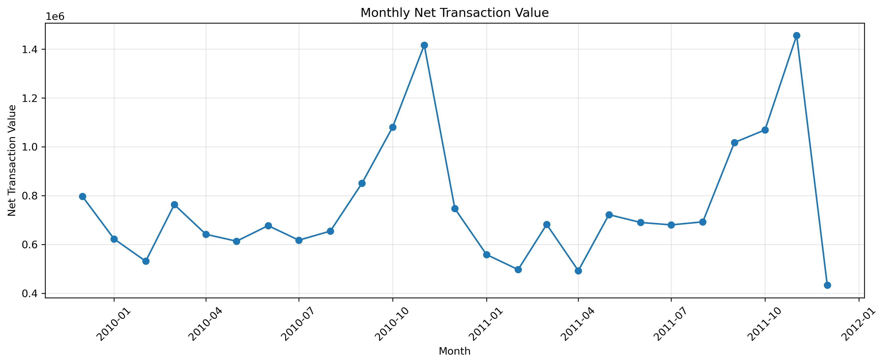
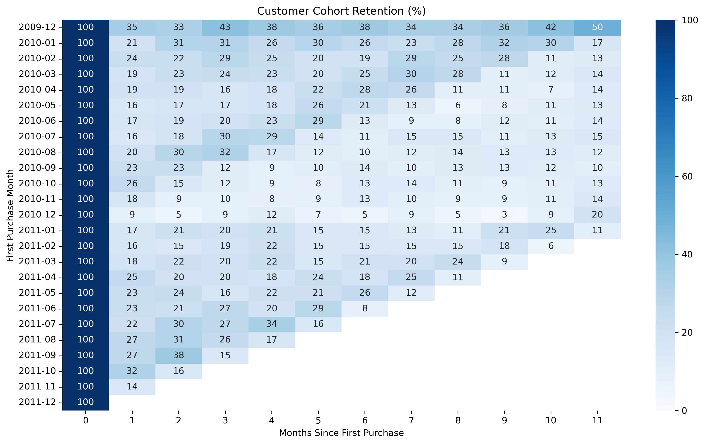
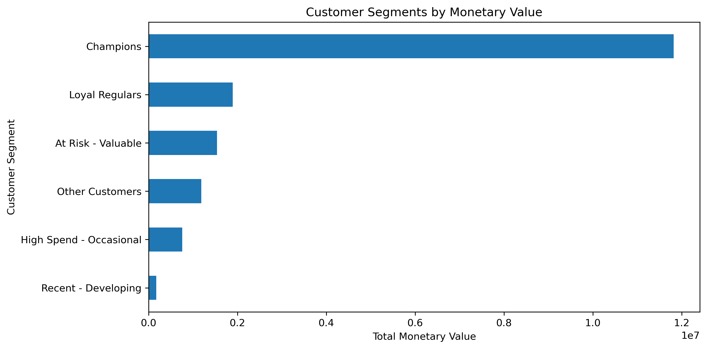

# Online Retail II: Revenue, Retention & Customer Value

A Python, Pandas and MySQL project analysing historical retail transactions to understand revenue patterns, customer retention, customer concentration and purchasing behaviour.

## Business Objective

The objective is to turn raw transaction data into actionable business findings by investigating:

- Monthly transaction value and country-level performance
- Data quality, cancellations and unusual financial adjustments
- Customer revenue concentration and repeat purchasing
- Customer retention across acquisition-month cohorts
- RFM customer segments and differences between one-time and repeat customers

## Dataset

Source: [UCI Online Retail II](https://archive.ics.uci.edu/dataset/502/online+retail+ii)

The original Excel workbook contains 1,067,371 transaction rows across two worksheets, covering December 2009 through December 2011. The final observation period ends on 9 December 2011.

The raw workbook and processed CSV are not included in this repository. Download the source dataset and follow the project workflow to reproduce the analysis.

## Tools & Skills

- **Python:** Pandas, NumPy, Matplotlib, Seaborn
- **SQL:** MySQL Workbench, aggregation, filtering, grouping, CTEs and date functions
- **Statistics:** Mann–Whitney U test
- **Analytics:** Data-quality auditing, cohort retention, customer concentration and RFM segmentation
- **Git/GitHub:** Version control and project documentation

## Key Findings

The figures below are from this project's analysis. Transaction-value metrics are not audited financial statements.

1. **Data quality:** 243,007 rows (22.77%) have missing Customer IDs in the original dataset. There are 34,335 extra occurrences of fully duplicated rows.
2. **Monthly performance:** November 2011 has the highest monthly net transaction line value in the analysis, at 1,456,145.80. December 2011 is incomplete, so its value is not directly comparable to a full month.
3. **Country concentration:** The United Kingdom has a net transaction line value of 16,133,674.42 in the cleaned transaction dataset.
4. **Customer concentration:** The top 20% of identified customers account for 77.39% of identified-customer net transaction value.
5. **Customer retention:** Retention varies by acquisition cohort. For the December 2009 cohort, 35.3% of customers purchased again in the following calendar month.
6. **RFM segmentation:** The Champions segment represents 21.93% of the customers classified and 68.03% of the monetary value in the RFM analysis.
7. **One-time vs repeat customers:** Mean customer-level average order value is 345.21 for one-time customers and 400.43 for repeat customers. A two-sided Mann–Whitney U test returned p ≈ 9.1 × 10⁻³⁰, indicating a statistically significant difference in the distributions of average order values.

## Visualisations

### Monthly Net Transaction Value



### Customer Cohort Retention



### Customer Segments by Monetary Value



## Methodology

1. Loaded both Excel worksheets and combined them into one DataFrame.
2. Inspected column types, missing values, duplicate records, cancellation invoices and unusual prices.
3. Removed exact duplicate rows from the analysis copy and separated six rows whose descriptions contained “bad debt”.
4. Calculated transaction line value as `Quantity × Price`.
5. Analysed monthly trends, country performance, product performance and customer concentration.
6. Built monthly customer cohorts and calculated retention rates.
7. Calculated Recency, Frequency and Monetary metrics and applied rule-based RFM scores and segments.
8. Used a Mann–Whitney U test to compare customer-level average order values between one-time and repeat customers.
9. Repeated selected aggregations in MySQL Workbench to validate the Python results.

## SQL Analysis

The SQL script is available at [`sql/queries.sql`](sql/queries.sql).

It includes queries for:

- Monthly transaction value
- Country performance
- Product performance
- Cancellation-related transactions
- Top customers
- One-time versus repeat customers

## Limitations

- The data is historical and does not represent current retailer performance.
- December 2011 is incomplete.
- Missing Customer IDs limit customer-level analysis.
- Identical transaction rows were removed based on exact matches; this assumes those repeated rows are duplicates and may not reflect every business circumstance.
- Cancellation-related transactions and negative quantities remain in some net transaction-value measures. These figures should not be interpreted as final merchandise revenue.
- RFM segments use project-defined rules and are descriptive, not validated predictions of future customer behaviour.
- Statistical significance does not establish that repeat purchasing causes higher average order values.

## How to Reproduce

1. Download the workbook from the UCI dataset page linked above.
2. Place it at `data/raw/online_retail_II.xlsx`.
3. Install the dependencies using `pip install -r requirements.txt`.
4. Open and run the analysis notebook in `notebooks/`.
5. Use MySQL Workbench to import the exported transaction CSV and execute `sql/queries.sql`.

## Repository Structure

```text
retail-revenue-retention-analysis/
├── data/
│   ├── raw/                 # Original dataset; not committed
│   └── processed/           # Processed files; not committed
├── notebooks/
│   └── 01_load_and_inspect.ipynb
├── reports/
│   └── figures/
├── sql/
│   └── queries.sql
├── .gitignore
├── requirements.txt
└── README.md
```

